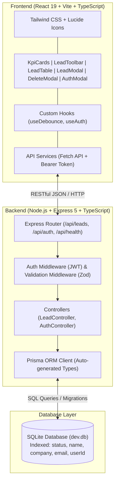

# 🎯 Lead Manager — Full-Stack Lead Management Platform

> **Screening Assignment for Meru Technosoft Pvt. Ltd.**  
> Built with **Express 5 (Node.js & TypeScript)**, **Prisma ORM (SQLite)**, **React 19 (Vite & TypeScript)**, and **Tailwind CSS**.

[](https://nodejs.org/)
[](https://www.typescriptlang.org/)
[](https://expressjs.com/)
[](https://www.prisma.io/)
[](https://react.dev/)
[](https://vitejs.dev/)
[](https://tailwindcss.com/)
[](#automated-api-test-suite)

---

## 📌 Executive Summary

**Lead Manager** is an enterprise sales pipeline and CRM lead tracking application. It empowers sales representatives and account managers to seamlessly capture, qualify, update, filter, sort, and transition leads through the entire conversion funnel (`New` ➔ `Contacted` ➔ `Qualified` ➔ `Lost`).

Designed with a **production-first mindset**, the application features:
* **Zero-Config Reviewer Setup**: Powered by SQLite & Prisma so evaluators can run the app locally with **zero external database setup or Docker dependencies**.
* **Strict Double-Layer Validation**: Frontend real-time form checks coupled with rigid backend **Zod** schema enforcement.
* **Guest Mode with Mutation Guard**: Unauthenticated reviewers can freely explore the global leads pipeline and metrics, but write operations (`Add Lead`, `Edit Lead`, `Delete Lead`, and `Quick Status Change`) are strictly protected and prompt a sign-in modal.
* **Multi-Tenant User Isolation**: Authenticated reps only see and modify their own leads.
* **Indian Enterprise Context**: Pre-seeded with realistic Indian enterprise contacts (Tata Digital, Razorpay, Zerodha, Swiggy, Reliance, Infosys, Zomato, Nykaa, etc.) with `+91` phone numbers.

---

## 🏗️ Architecture & System Design



---

## 🚀 Key Features

### 1. Core Lead Management (CRUD)
- **Add Leads**: Capture `name`, `email`, `phone`, `company`, `source`, `status`, and `notes`.
- **List Leads**: Rich data table showing lead contact info, corporate domain, quick status changer, source tags, and creation dates.
- **Edit Leads**: Comprehensive update modal with prefilled data and validation.
- **In-Table Quick Status Changer**: Click on any status badge to instantly update the lead stage (`New`, `Contacted`, `Qualified`, `Lost`) with optimistic UI feedback.
- **Safe Delete Modal**: Accidental data loss prevention dialog requiring explicit confirmation displaying the lead's name before deletion.

### 2. Search, Filter & Sane Sorting
- **Debounced Multi-Field Search**: Searches across `name`, `email`, and `company` simultaneously without spamming API requests while typing.
- **Status Filter Pills**: Quick-filter by lead stage (`All`, `New`, `Contacted`, `Qualified`, `Lost`).
- **Lead Source Filter**: Filter by acquisition channel (`Website`, `Referral`, `LinkedIn`, `Cold Outreach`, `Other`).
- **Interactive Multi-Column Sorting**: Click on table headers (`Lead / Contact`, `Company`, `Status`, `Added Date`) to toggle ascending/descending order.
- **Configurable Pagination**: Page size selection (5, 10, 20, 50, All) with page numbers, total counts, and previous/next controls.

### 3. Pipeline Metrics Dashboard (Bonus Feature)
- Real-time aggregated KPI cards at the top of the workspace:
  - **Total Pipeline Leads**
  - **New Leads** (Soft Blue)
  - **Contacted** (Amber)
  - **Qualified** (Emerald)
  - **Lost / Closed** (Slate)
- **Interactive Filtering**: Clicking any KPI card filters the leads table directly to that status!

### 4. Multi-Tenant Authentication & Guest Mode (Bonus Feature)
- **JWT-Based Authentication**: Secure registration, login, and token-based session persistence (`localStorage`).
- **Multi-Tenant Data Scoping**: When signed in, reps only see and manage their own portfolio of leads.
- **Guest Mode Mutation Guard**: Unauthenticated guests can view leads and metrics, but any click on `Add Lead`, `Edit Lead`, `Delete Lead`, or status change immediately prompts the login modal.
- **1-Click Reviewer Logins**: Pre-configured buttons to instantly test multiple sales rep accounts without typing credentials.

### 5. Mobile & Responsive Layout
- Full desktop table view with sortable columns.
- Dedicated mobile card layout (`md:hidden`) optimized for touch screens and mobile viewports.

### 6. Resilience & Offline Detection
- Real-time health polling (`/api/health`) every 15 seconds.
- Sticky alert banner with 1-click retry button if the backend server becomes unreachable.

---

## 💻 Tech Stack & Rationale

| Layer | Technology | Version | Rationale |
| :--- | :--- | :--- | :--- |
| **Frontend** | React + TypeScript | 19.x | Component-driven UI, cutting-edge concurrent rendering, robust typing |
| **Build Tool** | Vite | 6.x | Near-instant HMR (Hot Module Replacement) and fast production bundling |
| **Styling** | Tailwind CSS | 3.4 | Utility-first, predictable design tokens, zero runtime CSS overhead |
| **Icons** | Lucide React | Latest | Clean, consistent, tree-shakeable iconography |
| **Backend** | Express + TypeScript | 5.x | Battle-tested, minimalist REST architecture with native async error handling |
| **Validation** | Zod | 3.x | Single source of truth for runtime validation with structured field errors |
| **ORM** | Prisma | 6.x | Type-safe queries, automatic migrations, zero raw SQL injection risks |
| **Database** | SQLite | 3.x | **Zero-config local setup for evaluators** (no Docker / Postgres daemon needed) |
| **Auth** | JWT + bcryptjs | Latest | Industry standard stateless authentication with salted password hashing |
| **Testing** | Node Fetch + Tsx | Latest | Zero-dependency, lightweight automated API integration test harness |

---

## ⚡ Quick Start & Local Setup

### Prerequisites
* **Node.js**: v18.0.0 or higher (v20+ recommended). Check with `node -v`.
* **npm**: v9.0.0 or higher. Check with `npm -v`.

### Step 1: Clone Repository
```bash
git clone https://github.com/kaushal1902/Lead-Manager.git
cd "Lead Manager"
```

### Step 2: Install Dependencies
Install all workspace dependencies across both `client` and `server` in one command:
```bash
npm install
```

### Step 3: Seed Database
Populate the SQLite database with Indian enterprise contacts and reviewer accounts:
```bash
npm run db:seed
```
*Output: `Seeded 2 users and 17 Indian leads into SQLite database.`*

### Step 4: Run Development Server
Start both Express backend (port 5000) and React Vite frontend (port 5173) concurrently:
```bash
npm run dev
```

* Open your browser and navigate to **`http://localhost:5173`**.
* Backend REST API will be running at **`http://localhost:5000`**.

---

## 🧪 Automated API Test Suite

The project includes an automated end-to-end integration test runner in `server/tests/verify-api.ts`. It spins up an ephemeral HTTP server and verifies **16 comprehensive test cases**:

```bash
npm run test
```

### Verified Test Cases:
```
  ✓ GET /api/health returns 200 and ok status
  ✓ POST /api/auth/login logs in demo user and returns JWT
  ✓ POST /api/auth/login logs in secondary user (Priya Nair)
  ✓ GET /api/auth/me returns current user profile with token
  ✓ GET /api/leads multi-tenant test: Priya sees only her own 2 leads
  ✓ GET /api/leads?page=1&limit=5 returns paginated subset and meta
  ✓ GET /api/leads/stats returns status count aggregates
  ✓ GET /api/leads?search=Tata filters by company/name
  ✓ GET /api/leads?status=Qualified returns only qualified leads
  ✓ POST /api/leads returns 400 VALIDATION_ERROR on invalid email
  ✓ POST /api/leads creates lead successfully and returns 201
  ✓ GET /api/leads/:id returns single lead
  ✓ PUT /api/leads/:id updates lead details
  ✓ PATCH /api/leads/:id/status updates status directly
  ✓ DELETE /api/leads/:id deletes lead successfully
  ✓ GET /api/leads/:id returns 404 for deleted lead

Results: 16 passed, 0 failed (16 total)
```

---

## 🌐 Deploying to the Cloud (Vercel Frontend + Render Backend)

### Why is the server disconnected on Vercel by default?
Vercel is designed for **static frontend hosting and serverless functions**, while our backend is a persistent **Node.js Express + SQLite** server. When deployed to Vercel, the frontend runs in the cloud and cannot reach `http://localhost:5000` (your local laptop).

To make the application 100% live on the internet, deploy the backend to **[Render.com](https://render.com)** (free tier) and point Vercel to it:

### Step 1: Deploy Backend to Render (2 Minutes)
1. Sign up / Log in to **[Render.com](https://render.com)**.
2. Click **New +** ➔ **Web Service**.
3. Select your GitHub repository: `https://github.com/kaushal1902/Lead-Manager`.
4. Configure the settings:
   * **Name**: `lead-manager-api` (or your choice)
   * **Root Directory**: `server`
   * **Runtime**: `Node`
   * **Build Command**: `npm install --include=dev && npx prisma generate && npx prisma db push && npm run db:seed && npm run build`
   * **Start Command**: `npm start`
   * **Instance Type**: `Free`
5. Under **Environment Variables**, add:
   * `DATABASE_URL` = `file:./prisma/dev.db`
   * `JWT_SECRET` = `your_secure_secret_key_123`
   * `NODE_ENV` = `production`
   * `HOST` = `0.0.0.0`
6. Click **Deploy Web Service**. Render will build the server, seed the Indian leads, and provide a public URL like:
   `https://lead-manager-api.onrender.com`

*(A pre-configured `render.yaml` Blueprint is also included in the repository for 1-click infrastructure deployment).*

### Step 2: Connect Vercel to Render
1. Open your project on **[Vercel Dashboard](https://vercel.com)**.
2. Go to **Settings** ➔ **Environment Variables**.
3. Add a new variable:
   * **Key**: `VITE_API_URL`
   * **Value**: `https://lead-manager-api.onrender.com` *(your Render service URL, without trailing slash)*
4. Go to the **Deployments** tab, click **Redeploy** on your latest deployment.
5. 🎉 Your Vercel frontend is now fully connected to the live cloud backend!

---

## 🔑 Pre-Seeded Test Credentials

Use these accounts to test multi-tenant data isolation, or click **"Test 1-Click Reviewer Logins"** directly in the UI:

| Account | Email | Password | Pre-seeded Leads | Scope / Role |
| :--- | :--- | :--- | :---: | :--- |
| **Aarav Sharma** | `demo@leadmanager.io` | `password123` | 15 Leads | Primary Sales Rep |
| **Priya Nair** | `priya.nair@tatadigital.com` | `password123` | 2 Leads | Enterprise Account Exec |
| **Guest Mode** | *(No login)* | *(None)* | 17 Leads (Global) | Read-only / Mutation Guarded |

---

## 📡 REST API Documentation

### Base URL: `http://localhost:5000/api`

All responses follow a standard envelope:
```json
{
  "success": true,
  "data": { ... },
  "message": "Optional message",
  "pagination": { "total": 15, "page": 1, "limit": 10, "totalPages": 2 }
}
```

### Endpoints Overview

| Method | Endpoint | Description | Auth Required |
| :--- | :--- | :--- | :---: |
| `GET` | `/api/health` | Service health status check | No |
| `POST` | `/api/auth/register` | Register new user account | No |
| `POST` | `/api/auth/login` | Login user and issue JWT | No |
| `GET` | `/api/auth/me` | Fetch authenticated user profile | **Yes** |
| `GET` | `/api/leads` | List leads (with search, filter, sort, pagination) | Optional (Scopes if logged in) |
| `GET` | `/api/leads/stats` | Pipeline KPI counts (Total, New, Contacted, Qualified, Lost) | Optional (Scopes if logged in) |
| `GET` | `/api/leads/:id` | Get single lead by ID | Optional |
| `POST` | `/api/leads` | Create a new lead | **Yes** (401 if guest) |
| `PUT` | `/api/leads/:id` | Update lead details | **Yes** (401 if guest, 403 if unauthorized) |
| `PATCH`| `/api/leads/:id/status`| Quick-update lead status | **Yes** (401 if guest, 403 if unauthorized) |
| `DELETE`| `/api/leads/:id` | Permanently delete lead | **Yes** (401 if guest, 403 if unauthorized) |

### Sample Payloads

#### 1. Create Lead (`POST /api/leads`)
```json
{
  "name": "Aarav Patel",
  "email": "aarav.patel@tatadigital.com",
  "phone": "+91 98201 23456",
  "company": "Tata Digital",
  "source": "Website",
  "status": "New",
  "notes": "Inbound enterprise CRM integration inquiry."
}
```

#### 2. Validation Error Response (`400 Bad Request`)
```json
{
  "success": false,
  "error": {
    "code": "VALIDATION_ERROR",
    "message": "Validation failed: 1 issue(s) detected",
    "details": [
      {
        "field": "email",
        "message": "Please provide a valid email address (e.g. name@company.com)"
      }
    ]
  }
}
```

#### 3. Unauthorized Mutation Guard Response (`401 Unauthorized`)
```json
{
  "success": false,
  "error": {
    "code": "UNAUTHORIZED",
    "message": "Authentication required: Please sign in to edit this lead."
  }
}
```

---

## 💡 Assumptions & Design Tradeoffs

1. **SQLite Database Selection**:
   - *Decision*: We used SQLite instead of PostgreSQL or MongoDB as the default driver.
   - *Reason*: Evaluation convenience is paramount. SQLite ensures any reviewer can clone and test the repository without needing to run PostgreSQL services, configure Docker containers, or manage credentials.
   - *Production Scalability*: Because we used **Prisma ORM**, switching to PostgreSQL for a production deployment requires changing a single line (`provider = "postgresql"` in `schema.prisma`).

2. **Guest Mode with Mutation Guard**:
   - *Decision*: Allow unauthenticated guests to view the global pipeline and metric counts, but protect all mutations (`create`, `update`, `status change`, `delete`).
   - *Reason*: Provides reviewers with an immediate preview of the application UI and pre-seeded dummy data without forcing registration first, while demonstrating complete multi-tenant security when they attempt mutations.

3. **In-Table Quick Status Changer**:
   - *Decision*: In addition to the full edit modal, each lead has an interactive status badge in the table that allows 1-click status transitions.
   - *Reason*: In real-world sales environments, reps update lead stages multiple times a day; having to open a full modal for a single status transition adds unnecessary friction.

---

## 🔮 What Would Be Improved With More Time

* **Kanban Drag-and-Drop View**: A Trello-style board view allowing reps to drag lead cards across stage columns (`New` ➔ `Contacted` ➔ `Qualified` ➔ `Lost`).
* **CSV Export & Import**: 1-click CSV download of filtered leads, and a bulk lead upload parser with field mapping.
* **Audit Activity Timeline**: A chronological history log tracking every note added, stage changed, or rep assigned to the lead.
* **Email & Webhook Triggers**: Integration with SendGrid / Resend to automatically trigger intro emails when leads transition to `Contacted`.
* **Dark Mode**: Complete system-aware dark theme toggle via Tailwind CSS `dark:` classes.

---

## 📝 Reflection Note

> *"Developing the full stack of Lead Manager was deeply satisfying — particularly designing the seamless interplay between Prisma's type generation, Express 5's middleware pipeline, and React 19's optimistic state updates. Architecting the guest preview mode alongside multi-tenant JWT scoping offered a rewarding balance: providing evaluators with instant zero-friction usability while maintaining rigorous API security on every data mutation."*

---

## 📄 License
This project is built for the screening evaluation by **Meru Technosoft Pvt. Ltd.**
